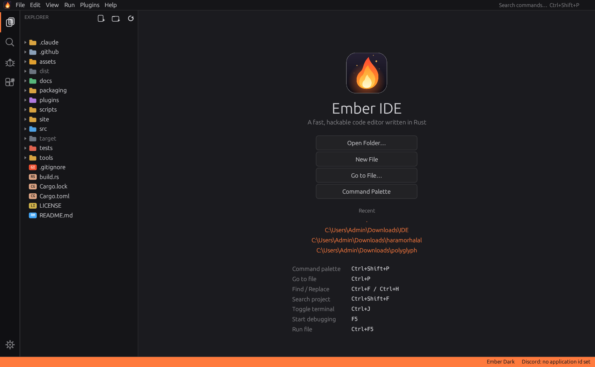
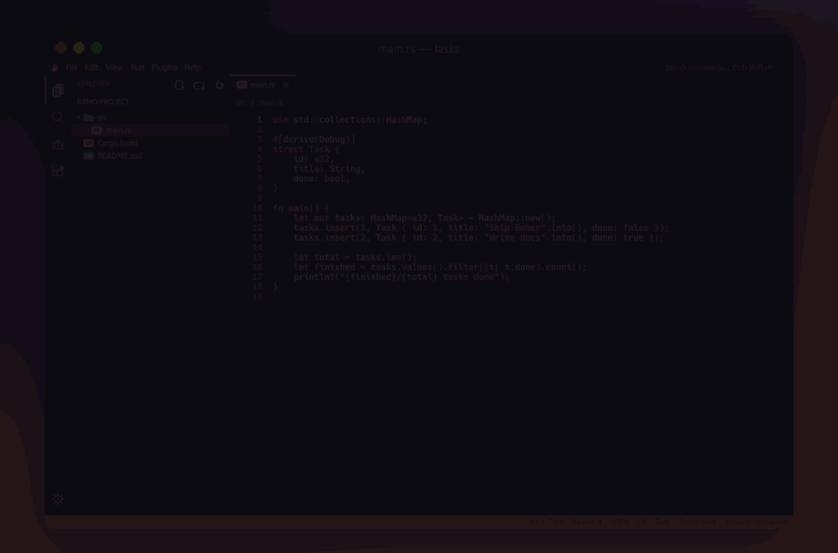
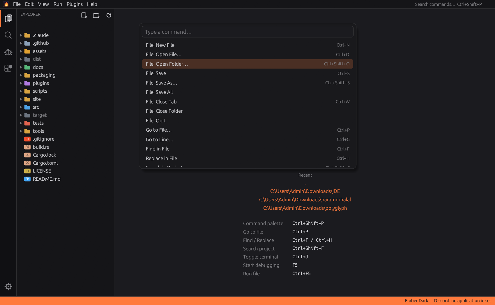
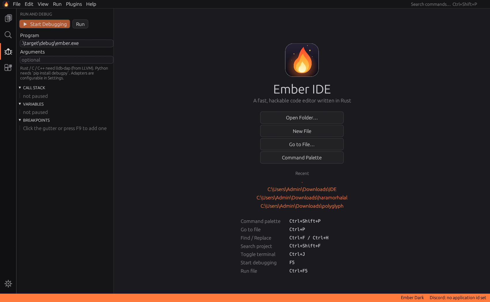
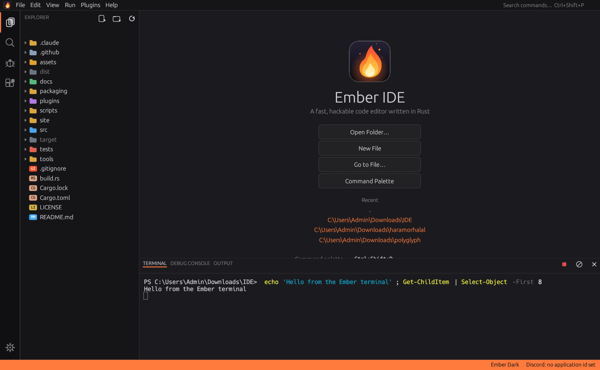
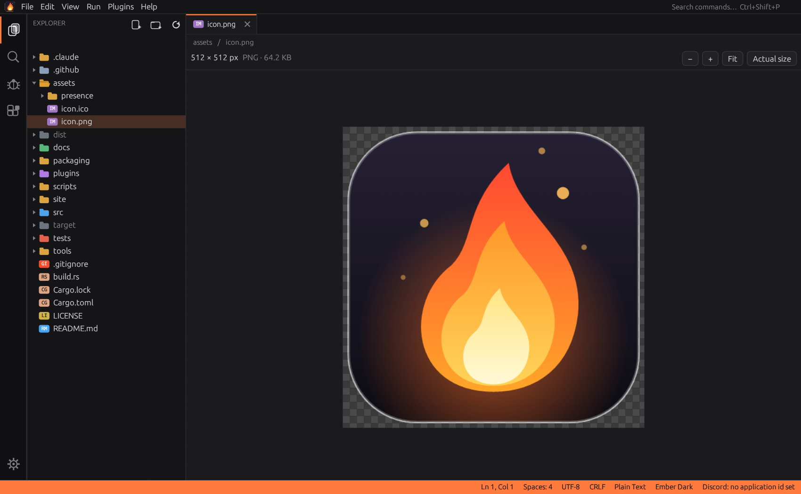
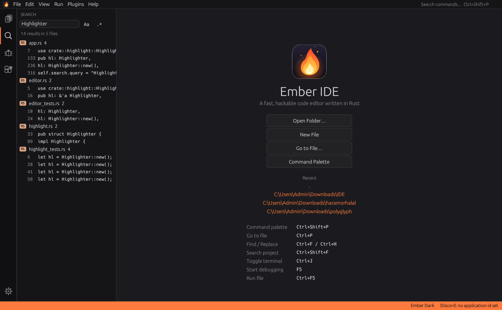
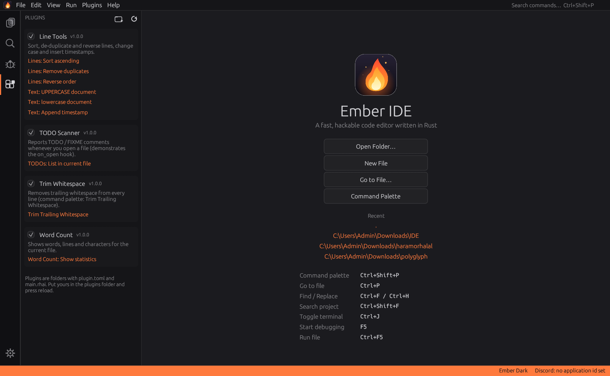
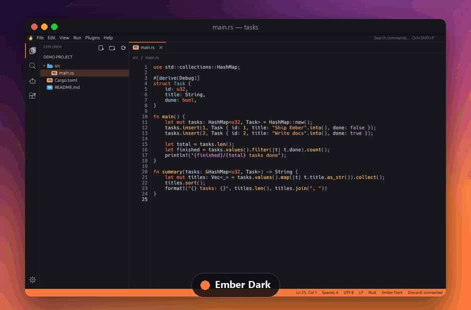
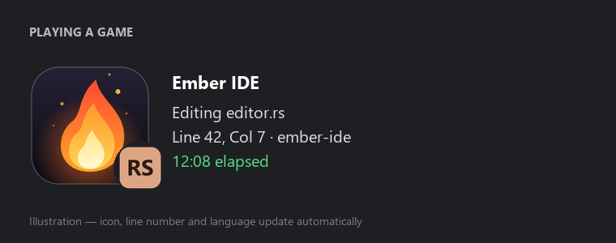

<p align="center"></p>

<h1 align="center">Ember IDE</h1>

<p align="center"><b>A fast, themeable, cross-platform code editor written in Rust.</b><br>
Real terminal · debugger · plugin system · 12 themes · automatic Discord rich presence</p>

<p align="center">
  <a href="../../releases/latest"></a>
  <a href="../../actions/workflows/ci.yml"></a>
  
  
  
</p>

<p align="center">
  <a href="#install">Install</a> ·
  <a href="#features">Features</a> ·
  <a href="#themes">Themes</a> ·
  <a href="#plugins">Plugins</a> ·
  <a href="#debugger">Debugger</a> ·
  <a href="#building-from-source">Build</a> ·
  <a href="docs/ARCHITECTURE.md">Architecture</a>
</p>



<p align="center"></p>

---

## Install

Download from the **[Releases page](../../releases/latest)** — or use a one-liner.

| Platform | Download | Notes |
| --- | --- | --- |
| **Windows 10/11** (x64) | `Ember-IDE-Setup-x.y.z.exe` | Per-user or all-users, optional *Open with Ember IDE* context menu |
| Windows (x64 / ARM64) | `Ember-IDE-x.y.z-windows-<arch>-portable.zip` | No install, just run `ember.exe` |
| **macOS Apple Silicon** | `Ember-IDE-x.y.z-macos-aarch64.dmg` | M1 – M4 |
| **macOS Intel** | `Ember-IDE-x.y.z-macos-x86_64.dmg` | Right-click → Open on first launch (not notarized) |
| **Ubuntu / Debian / Mint** (x86_64) | `ember-ide_x.y.z_amd64.deb` | `sudo apt install ./ember-ide_*.deb` |
| **Raspberry Pi** (64-bit OS), ARM64 | `ember-ide_x.y.z_arm64.deb` | Pi 3/4/5 on Raspberry Pi OS 64-bit or Ubuntu |
| **Fedora / RHEL / openSUSE** | `ember-ide-x.y.z-1.x86_64.rpm` / `.aarch64.rpm` | `sudo dnf install ./ember-ide-*.rpm` |
| Any Linux / macOS | `Ember-IDE-x.y.z-<os>-<arch>.tar.gz` | Contains the binary, plugins and icon |

### One-liners

```bash
# Linux, macOS, Raspberry Pi — installs to ~/.local, no sudo
curl -fsSL https://raw.githubusercontent.com/topluau/ember-ide/main/scripts/install.sh | sh
```

```powershell
# Windows (PowerShell)
irm https://raw.githubusercontent.com/topluau/ember-ide/main/scripts/install.ps1 | iex
```

```bash
# Any platform with Rust installed
cargo install --git https://github.com/topluau/ember-ide ember
```

Every release ships a `SHA256SUMS.txt` so you can verify downloads.

> **Unsigned builds:** Windows SmartScreen may say "unknown publisher" (More info → Run anyway). On macOS, right-click the app → Open, or run `xattr -dr com.apple.quarantine "/Applications/Ember IDE.app"`.

## Features

- **Fast & native** — Rust + a GPU immediate-mode UI (egui/eframe). One ~12 MB binary, no Electron, no web views.
- **Real terminal** — a genuine pseudo-terminal (ConPTY on Windows, PTY on Unix) with a VT100 emulator: colours, history, tab completion, `vim`, `htop`, `git`, `cargo`. Scrollback, paste, resize.
- **Debugger** — Debug Adapter Protocol client: breakpoints, step over/in/out, call stack, lazily expanded variables, debug console with expression evaluation.
- **Plugins** — sandboxed [Rhai](https://rhai.rs) scripts with hooks and commands. Four bundled.
- **12 themes** — plus your own as TOML.
- **Discord rich presence** — automatic, no login: the file, the line and the language icon, with idle detection.
- **Image & binary viewer** — PNG, JPG, GIF, WebP, BMP, ICO, TIFF open as pictures with zoom and a transparency checkerboard; other binaries show a hex dump.
- **Editor** — incremental syntax highlighting, smart indent, auto-pairing, comment toggle, move/duplicate/delete line, multi-line indent, find & replace with regex.
- **Navigation** — command palette, quick open (fuzzy), go to line, threaded project-wide search, breadcrumbs, file explorer with create/rename/delete.
- **Output panel** — saves, runs, debugger events and plugin logs, right next to the terminal.
- **Code-drawn icons** — file-type badges and folder icons, no icon font to install.

### Screenshots

| Command palette | Debugger |
| --- | --- |
|  |  |
| **Terminal** | **Image viewer** |
|  |  |
| **Project search** | **Plugins** |
|  |  |

## Themes

Ember Dark · Ember Light · Dracula · Monokai · Nord · Solarized Dark · Solarized Light · Gruvbox Dark · Tokyo Night · One Dark · Catppuccin Mocha · GitHub Light

<p align="center"></p>

Switch with **Ctrl+Shift+P → Theme:** or in **Settings**. Custom themes: drop a `.toml` file into `<config dir>/ember/themes/` (see `src/theme.rs` for the keys).

## Discord rich presence

Open Discord (the desktop app) and open a file in Ember. That's it — **no login, no tokens, no setup.** Your activity shows:



- **Details:** `Editing main.rs` (or `Debugging …`, or `Idling on …` after 3 minutes of no input)
- **State:** `Line 42, Col 7 · project-name`
- **Icon:** the language of the current file (Rust, Python, JS, TS, C, C++, C#, Go, Java, Kotlin, Swift, Ruby, PHP, Lua, HTML, CSS, JSON, TOML, YAML, Markdown, shell…)
- **Timer:** time spent on the current file

Turn it off, or hide file/folder names, in **Settings → Discord**. Presence uses Discord's local IPC; nothing is sent anywhere else.

<details><summary>Maintainers: how the built-in application id and icons work</summary>

Release builds embed the Discord application id (`1571923030861553766`, see `src/config.rs`) so users configure nothing. The art assets in [`assets/presence/`](assets/presence) must be uploaded once under **Rich Presence → Art Assets** in the Discord developer portal; the file names without `.png` are the asset keys (`ember`, `rust`, `python`, …). To use a different application, set `EMBER_DISCORD_APP_ID` at build time (or as a repository variable for the release workflow). Users can also enter their own id in **Settings → Discord**.
</details>

## Plugins

A plugin is a folder with `plugin.toml` and `main.rhai`, loaded from `<config dir>/ember/plugins` or the install's `plugins/`.

```rhai
fn init() {
    register_command("shout.run", "Text: SHOUT");
}

fn on_command(id) {
    if id == "shout.run" {
        set_editor_text(editor_text().to_upper());
        notify("Done!");
    }
}
```

Hooks: `init`, `on_command`, `on_open`, `on_save`, `on_before_save`. Host API: `notify`, `log`, `editor_text`, `set_editor_text`, `current_file`, `project_root`, `open_file`, `register_command`, `now`, `rtrim`, `join`. Scripts are sandboxed with an operation budget, so a runaway plugin can't hang the editor. Full reference: [docs/PLUGINS.md](docs/PLUGINS.md). Bundled: **Line Tools**, **Word Count**, **TODO Scanner**, **Trim Whitespace**.

## Debugger

Install a Debug Adapter and make sure it is on `PATH` (or set its path in **Settings → Debug adapters**):

| Language | Adapter |
| --- | --- |
| Rust / C / C++ | `lldb-dap` (ships with LLVM) |
| Python | `pip install debugpy` |

Open a file → **F9** toggles a breakpoint → **F5** starts. Step with **F10 / F11**. Inspect the call stack and variables in the side panel; evaluate expressions in the Debug Console.

## Keyboard shortcuts

On macOS use <kbd>⌘</kbd> instead of <kbd>Ctrl</kbd>.

| Key | Action |
| --- | --- |
| `Ctrl+Shift+P` / `Ctrl+P` | Command palette / quick open |
| `Ctrl+S`, `Ctrl+N`, `Ctrl+O`, `Ctrl+W` | Save, new, open, close tab |
| `Ctrl+F`, `Ctrl+H`, `Ctrl+G` | Find, replace, go to line |
| `Ctrl+Shift+F` | Search in project |
| `Ctrl+J` | Toggle terminal / output panel |
| `Ctrl+B` | Toggle sidebar |
| `Ctrl+/` | Toggle comment |
| `Alt+↑/↓`, `Shift+Alt+↓`, `Ctrl+Shift+K` | Move, duplicate, delete line |
| `F5`, `Shift+F5`, `F9`, `F10`, `F11` | Debug start, stop, breakpoint, step over, step in |
| `Ctrl+F5` | Run current file |

Inside the terminal, keys go to the shell (only `Ctrl+J` and `Ctrl+Shift+P` stay global).

## Building from source

```bash
git clone https://github.com/topluau/ember-ide.git
cd ember-ide
cargo run --release            # launch
cargo test                     # unit tests + end-to-end debugger test
cargo run --release -- path/to/project --theme "Tokyo Night"
```

Linux build dependencies:

```bash
# Debian / Ubuntu / Raspberry Pi OS
sudo apt install build-essential pkg-config libgtk-3-dev libxkbcommon-dev libwayland-dev libxcb-render0-dev libxcb-shape0-dev libxcb-xfixes0-dev
# Fedora
sudo dnf install gcc pkgconf-pkg-config gtk3-devel libxkbcommon-devel wayland-devel libxcb-devel
```

Packaging: `iscc packaging\windows\installer.iss` (Inno Setup 6), `cargo deb`, `cargo generate-rpm`, `packaging/macos/build-dmg.sh`. Releases are built by GitHub Actions on every `v*` tag for Windows (x64, ARM64), macOS (Intel, Apple Silicon) and Linux (x86_64, ARM64).

### Command line

```
ember [PATH] [--theme NAME] [--screenshot OUT.png] [--ui palette|quickopen|settings|find|debug|plugins|search|terminal|image|welcome]
```

## Project layout

| Path | What |
| --- | --- |
| `src/` | the editor (see [docs/ARCHITECTURE.md](docs/ARCHITECTURE.md)) |
| `plugins/` | bundled Rhai plugins |
| `assets/` | icon, Discord language icons |
| `packaging/` | Windows installer, Linux desktop file, macOS bundle |
| `scripts/` | `install.sh`, `install.ps1` |
| `tests/` | end-to-end debugger test against a scripted adapter |

## Roadmap

Language server (LSP) support · split editors · git gutter & diff · multi-cursor · plugin marketplace · code signing / notarization.

## License

[MIT](LICENSE)
